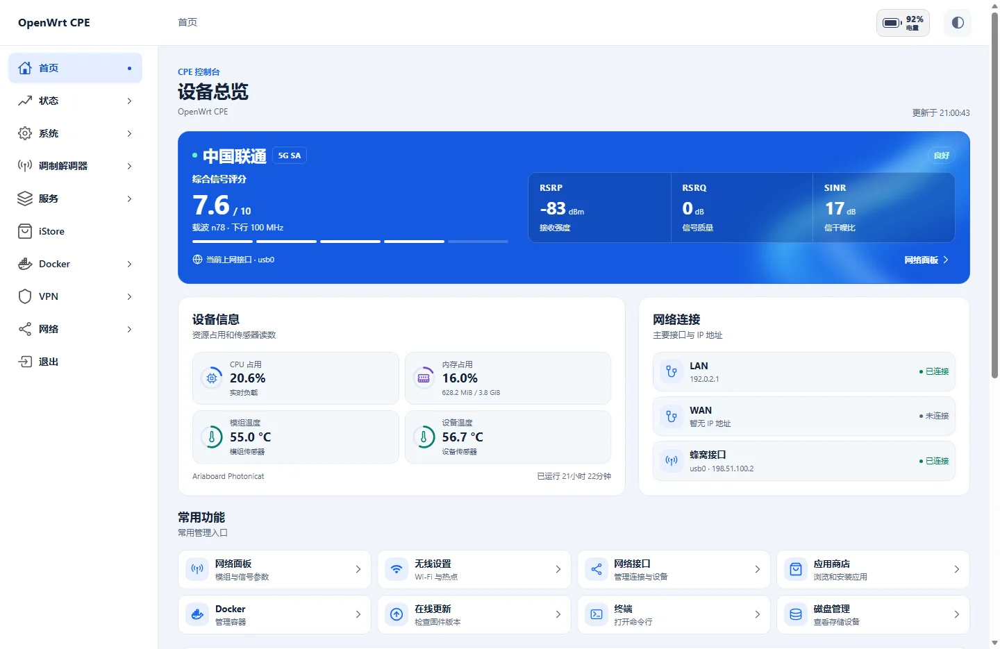

# wlmbstart for LuCI

**English** · [简体中文](README.zh-CN.md)

wlmbstart is a LuCI home page designed for 5G routers and CPEs. It shows the carrier and radio mode, RSRP/RSRQ/SINR, carrier aggregation, cellular interfaces, device load and temperatures, and live traffic. It reads the Rust Network Panel backend through the existing LuCI session.

Use [Apollo](https://github.com/SlAlot/luci-theme-apollo) with wlmbstart for a matching layout and navigation, including the optional header battery indicator. The dashboard also works with other LuCI themes.

## Preview



[Mobile preview](docs/images/mobile.webp)

## Compatibility

| OpenWrt | Release package |
| --- | --- |
| 23.05 | IPK |
| 24.10 | IPK |
| 25.12 | APK |

The frontend is architecture-independent. Install and start [wlmb-server 1.1.5 or later](https://github.com/SlAlot/wlmb-server/releases) first. The backend feed targets ARM64 (AArch64) and x86_64. Use a recent browser.

## Install

Download the package for your OpenWrt series from [Releases](https://github.com/SlAlot/luci-app-wlmbstart/releases). Transfer it to the router and run the command that matches its package manager.

```sh
opkg install ./luci-app-wlmbstart*.ipk
# OpenWrt 25.12
apk add --allow-untrusted ./luci-app-wlmbstart*.apk
```

Sign in to LuCI again and open the **Home** entry (`/cgi-bin/luci/admin/wlmbstart`).

## Build into your firmware

Add the following feeds to the active `feeds.conf` or `feeds.conf.default` in your OpenWrt source tree.

```text
src-git wlmbstart https://github.com/SlAlot/luci-app-wlmbstart.git;main
src-git wlmb https://github.com/SlAlot/wlmb-server.git;main
```

```sh
./scripts/feeds update -a
./scripts/feeds install -a
make menuconfig
```

Select `<*>` under **LuCI → Applications → luci-app-wlmbstart** and under **LuCI → Applications → wlmb-server**. Keep the standard `packages` feed enabled for the Rust toolchain. Save and build your firmware.

If the default feeds are already set up, update and install only the added feeds.

```sh
./scripts/feeds update wlmbstart wlmb
./scripts/feeds install -a -p wlmbstart
./scripts/feeds install -a -p wlmb
```

## Optional battery display

The dashboard battery indicator defaults to off. On a device with a compatible battery provider, set `uci set wlmbstart.main.show_battery='1'` and run `uci commit wlmbstart`. Use `0` to hide it again. This setting controls the dashboard indicator.

The 1-minute, 10-minute, and 1-hour charts use samples collected by the current browser. Today and billing-cycle totals come from wlmb-server.

## License

See [LICENSE](LICENSE) for SlAlot's non-commercial terms and [LICENSES](LICENSES) for third-party notices.
