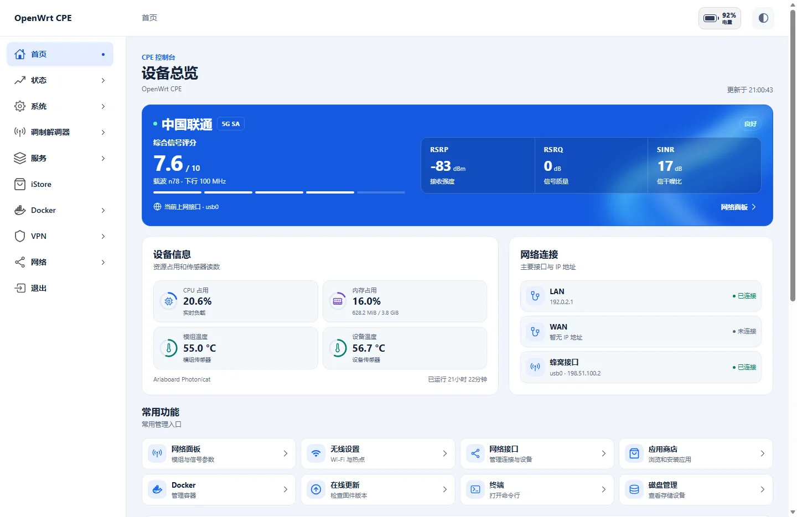

# wlmbstart 网络面板首页

[English](README.md) · **简体中文**

wlmbstart 是面向 5G 路由器与 CPE 的 LuCI 首页。集中显示运营商、制式、RSRP／RSRQ／SINR、载波聚合、蜂窝接口、设备负载与温度，以及实时流量。首页通过现有 LuCI 会话读取网络面板的 Rust 后端。

推荐搭配 [Apollo](https://github.com/SlAlot/luci-theme-apollo)，让首页、导航和可选的顶栏电量显示采用统一布局。首页也可以在其他 LuCI 主题下使用。

## 界面预览



[手机端预览](docs/images/mobile.webp)

## 兼容性

| OpenWrt | 安装包 |
| --- | --- |
| 23.05 | IPK |
| 24.10 | IPK |
| 25.12 | APK |

首页前端与 CPU 架构无关。安装前请先安装并启动 [wlmb-server 1.1.5 或更新版本](https://github.com/SlAlot/wlmb-server/releases)。后端 Feed 支持 ARM64（AArch64）和 x86_64。 请使用近期版本的浏览器。

## 安装

从 [Releases](https://github.com/SlAlot/luci-app-wlmbstart/releases) 下载对应 OpenWrt 版本的安装包，上传到路由器后执行对应命令。

```sh
opkg install ./luci-app-wlmbstart*.ipk
# OpenWrt 25.12
apk add --allow-untrusted ./luci-app-wlmbstart*.apk
```

重新登录 LuCI 后打开 **首页**（`/cgi-bin/luci/admin/wlmbstart`）。

## 快速编译进固件

在 OpenWrt 源码目录生效的 `feeds.conf` 或 `feeds.conf.default` 中加入：

```text
src-git wlmbstart https://github.com/SlAlot/luci-app-wlmbstart.git;main
src-git wlmb https://github.com/SlAlot/wlmb-server.git;main
```

```sh
./scripts/feeds update -a
./scripts/feeds install -a
make menuconfig
```

在 **LuCI → Applications → luci-app-wlmbstart** 选择 `<*>`，同时选择 **LuCI → Applications → wlmb-server**。保留官方 `packages` Feed，以便构建 Rust 后端。 保存配置后编译固件。

已经准备好默认 Feed 时，也可以只更新和安装本次新增的 Feed。

```sh
./scripts/feeds update wlmbstart wlmb
./scripts/feeds install -a -p wlmbstart
./scripts/feeds install -a -p wlmb
```

## 可选电量显示

首页电量默认关闭。支持电量数据的设备可运行 `uci set wlmbstart.main.show_battery='1'`，然后执行 `uci commit wlmbstart` 并刷新页面。改回 `0` 即可隐藏。此选项控制首页的电量显示。

1 分钟、10 分钟和 1 小时趋势图使用当前浏览器记录的样本，今日和账期流量由 wlmb-server 提供。

## 许可

原创部分采用 SlAlot 的非商业许可，见 [LICENSE](LICENSE)。第三方组件的声明见 [LICENSES](LICENSES)。
